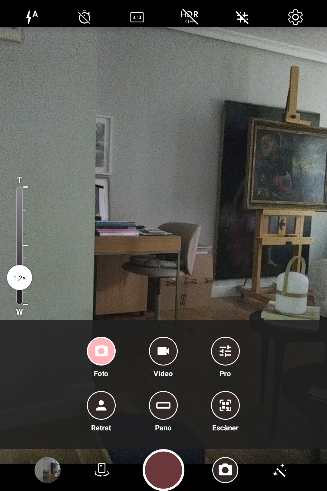
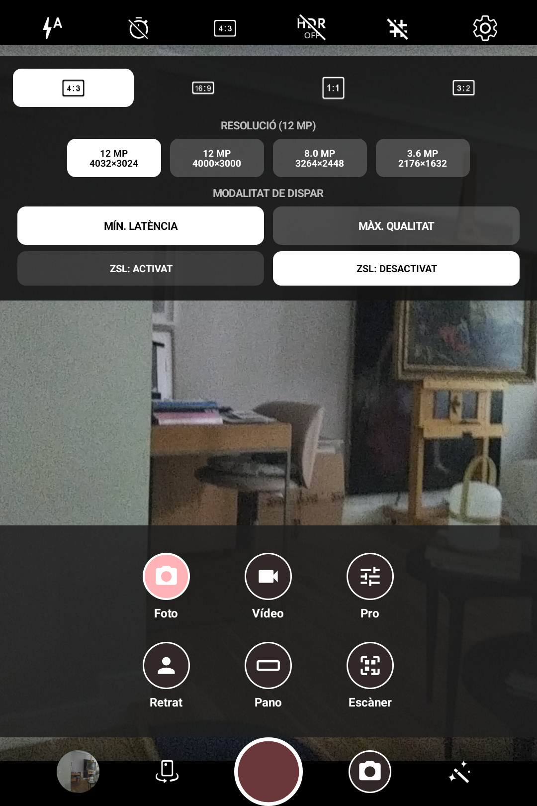
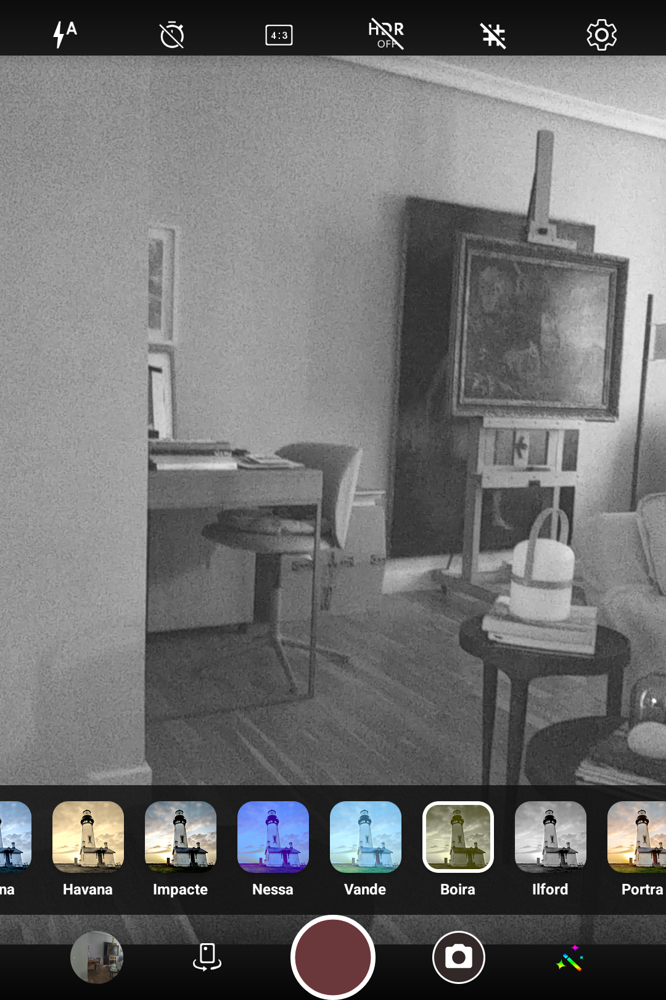
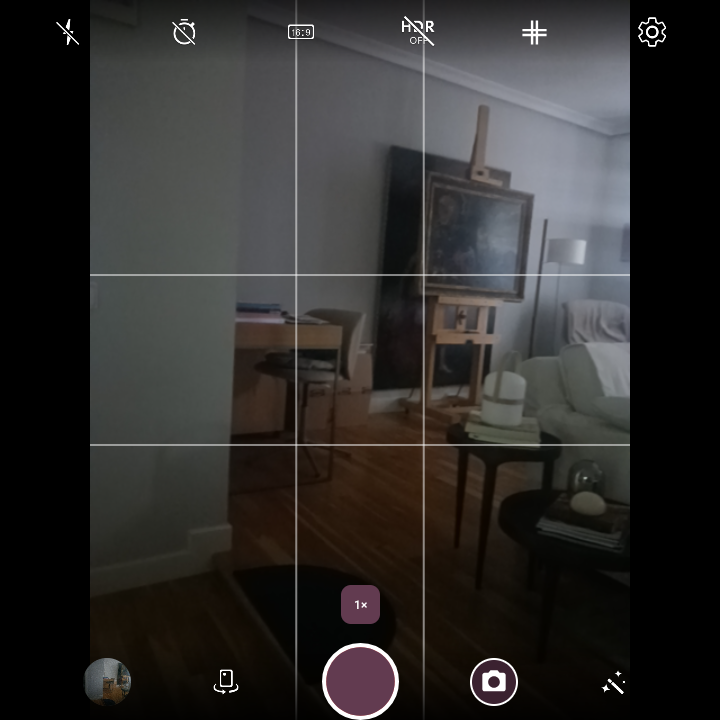
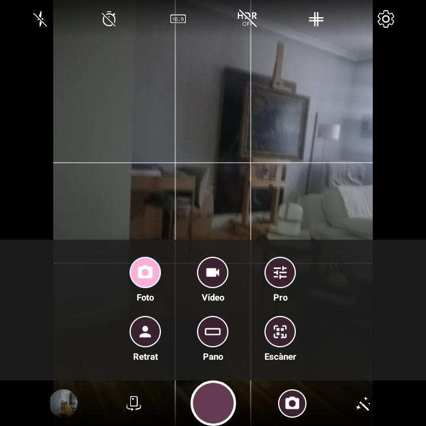
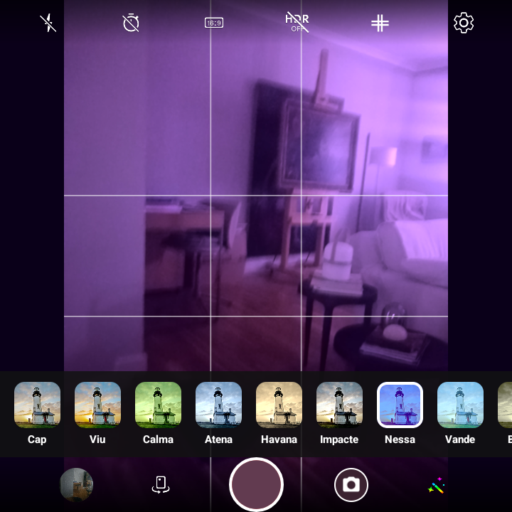
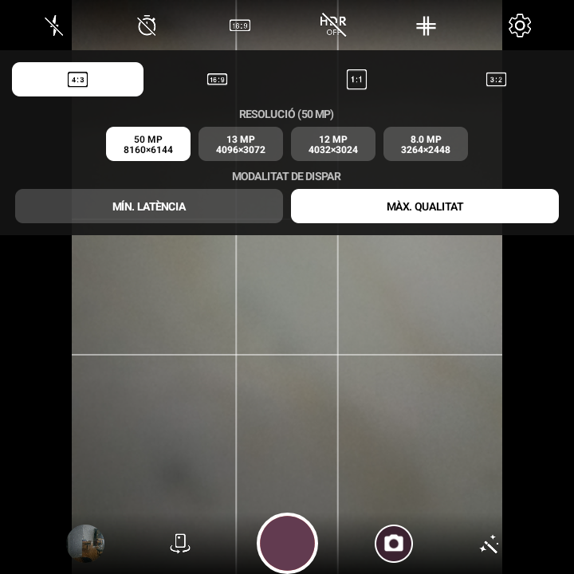
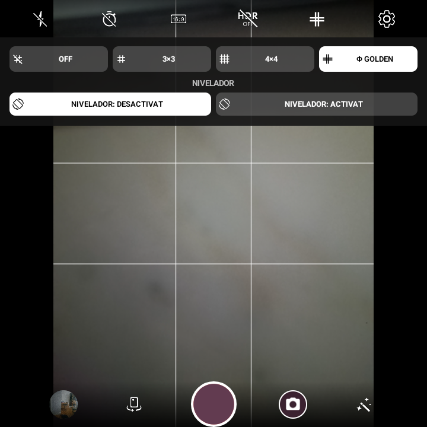

# Aperture - BlackBerry Edition

A customized, feature-rich camera app built on top of LineageOS Aperture and Android CameraX, redesigned with the iconic **BlackBerry Camera** UI/UX and **Material 3 Expressive** styling.

Specifically optimized and tested for keyboard-centric and unique form-factor devices such as the **BlackBerry KEY2** (capacitive touchpad keyboard) and the **Zinwa Q25** (square 720×720 display with physical trackball).

---

## 📸 Screenshots

### BlackBerry KEY2 (Portrait 3:2)

<p align="center">
  
  
  
</p>

### Zinwa Q25 (Square 1:1 / 720×720)

<p align="center">
  
  
  
  
  
</p>

---

## ✨ Features

### ⌨️ Hardware Controls & Physical Keyboard Integration
- **BlackBerry KEY2 Capacitive Touchpad Navigation**:
  - **Split Touchpad Controls**:
    - **Left Half** (letters Q–T, A–G, Alt–V): Controls smooth digital zoom with on-screen slider and tick marks.
    - **Right Half** (letters Y–P, H–Enter, B–$): Controls high-sensitivity **Exposure Compensation (+EV / -EV)**.
  - **Natural Scroll Direction**: Swipe UP to Zoom IN or increase brightness; swipe DOWN to Zoom OUT or darken.
- **Zinwa Q25 Trackball & D-pad Navigation**:
  - Roll up/down on the physical trackball or D-pad to smoothly adjust zoom.
- **Physical Shutter Keys**:
  - **Spacebar** (`KEYCODE_SPACE`) and **Enter Keys** (`KEYCODE_ENTER`, `KEYCODE_NUMPAD_ENTER`, `KEYCODE_DPAD_CENTER`) trigger instant photo capture or video recording toggle.

### 📐 Full-Sensor Optimized Aspect Ratio Pipeline
- **Native 4:3 Sensor Exploitation**: Hardware capture pipeline always leverages the full native 4:3 sensor area (e.g. 12.2 MP at 4032×3024) instead of low-quality hardware downscaling.
- **Supported Formats**: **4:3**, **16:9**, **1:1 (Square)**, and **3:2**.
- **1:1 Square Mode**: High-resolution centered crop using full vertical sensor height (**3024×3024** @ 9.15 MP) instead of hardware-degraded 2976×2976 crops.
- **16:9 Mode**: Full-dimension centered crop (**4032×2268** in landscape, **2268×4032** in portrait @ 9.14 MP).
- **Pixel-Accurate Viewfinder Framing**:
  - Viewfinder dynamically adapts to active ratio with black letterboxing / pillarboxing.
  - 3×3 grid lines, horizon leveler, and focus reticle perfectly match the captured photo area.

### 🔍 Live In-Viewfinder QR Detection
- Seamless, continuous QR code scanner built directly into the active viewfinder using **ZXing-cpp**.
- Instant on-screen interactive chip with one-tap link opening / clipboard copy without needing to switch modes.
- Dedicated **QR Scanner** mode in the drawer for full-screen barcode reading.

### 🎛️ BlackBerry Camera UX & Pro Controls
- **Iconic BlackBerry Styling**:
  - Top & bottom gradient decks with classic BlackBerry camera icons and styling.
  - Quick-access drawer for **Photo**, **Video**, **Pro**, and **QR Scanner** modes.
- **Pro / Manual Photography Controls**:
  - Direct on-screen manual dials for:
    - **EV** (Exposure Compensation)
    - **ISO** sensitivity
    - **Shutter Speed**
    - **White Balance (AWB)** presets
    - **Manual Focus (MF)** distance slider
- **Live Color Filters Ribbon**:
  - Real-time thumbnail previews with iconic film simulations: *Normal*, *Portra 160*, *Ilford B&W*, *Agapantha*, *Infrared*, *Sepia*, *Freeze*, and *Negative*.

### ⚡ Capture Latency & Zero Shutter Lag
- Two-tiered latency configuration:
  - **Min Latency** (Fast capture pipeline) with optional **ZSL (Zero Shutter Lag)** on/off toggle.
  - **Max Quality** (Multi-frame post-processing and maximum image quality).

### 🌐 Multilingual Support
- Fully localized in **English**, **Spanish** (*Español*), and **Catalan** (*Català*).

---

## 📱 Supported Devices

- **BlackBerry KEY2** (Android 8.1 Oreo through Android 16 / LineageOS)
- **Zinwa Q25** (Square 720×720 display, physical trackball)
- **Any Android device** running Android 8.0+ (API 26+)

*Note: Uses package ID `org.lineageos.aperture.blackberry`, allowing it to install alongside stock LineageOS Aperture without conflicts.*

---

## 🚀 Installation & Releases

Download pre-compiled, signed APKs from [GitHub Releases](https://github.com/nozerorma/aperture-blackberry/releases).

### Build from source
```bash
# Debug build
./gradlew assembleDebug

# Optimized Release build (ProGuard / R8)
./gradlew assembleRelease
```

Output APK will be located at:
```
app/build/outputs/apk/release/app-release.apk
```

### Install via ADB
```bash
adb install -r app/build/outputs/apk/release/app-release.apk
```

---

## 📄 License

Based on [LineageOS Aperture](https://github.com/LineageOS/android_packages_apps_Aperture), licensed under the Apache License, Version 2.0.
